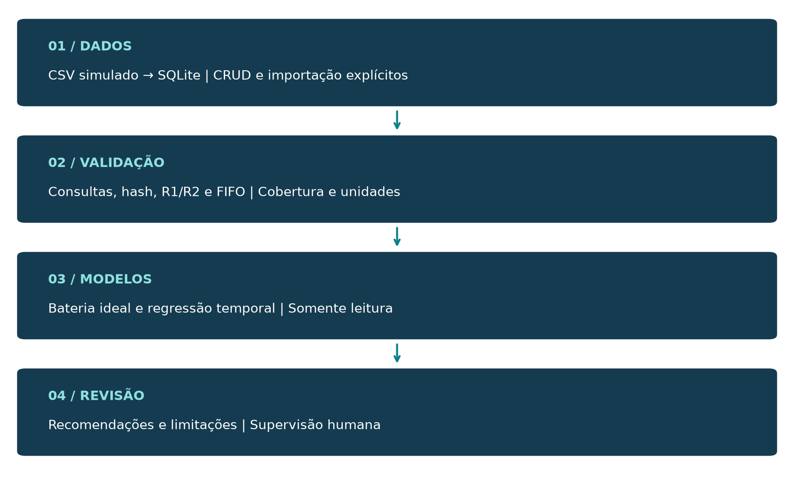
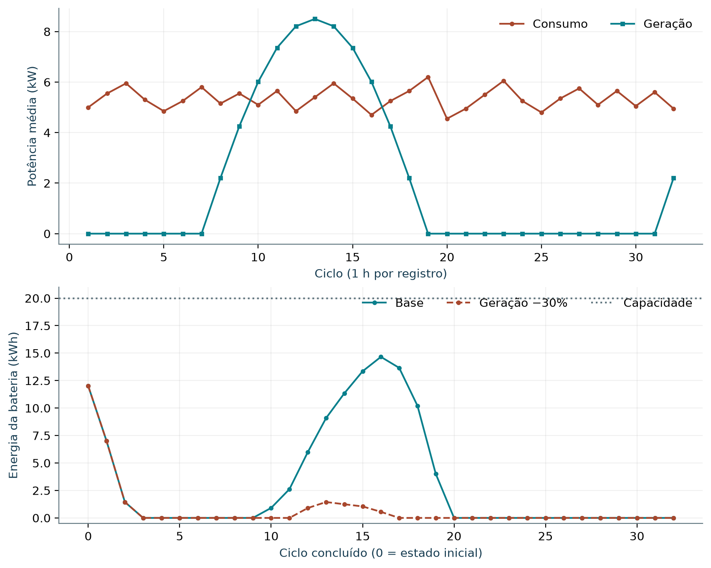
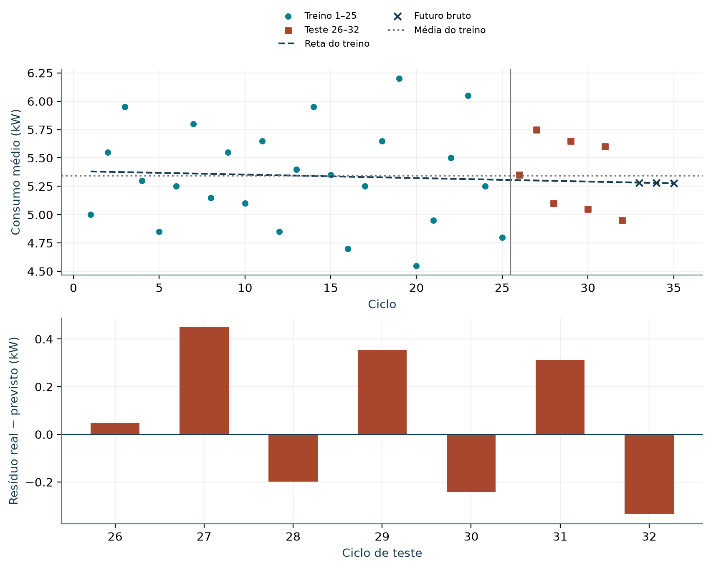

# Sistema Integrado de Futuro Sustentável em Marte: Aurora Siger

## Resumo

Este relatório apresenta o Sistema Integrado de Futuro Sustentável em Marte (SIFSM), um protótipo acadêmico para organizar dados e apoiar decisões sobre recursos de uma colônia simulada. O objetivo é integrar persistência, regras booleanas, estruturas de dados, balanço energético, regressão linear e agentes determinísticos em uma aplicação de terminal. O método utiliza Python, SQLite e uma base simulada com cinco módulos, dez sensores e 320 leituras distribuídas em 32 ciclos. As potências médias são integradas em intervalos de uma hora e alimentam um modelo de bateria ideal com capacidade finita. A regressão é ajustada nos primeiros 25 ciclos e avaliada nos sete posteriores, em comparação com a média do treino. O cenário-base apresenta consumo de 171,05 kWh, geração de 66,76 kWh e demanda não atendida de 92,29 kWh. O erro absoluto médio da regressão é de 0,2766813 kW, superior aos 0,2722857 kW da referência. Por isso, as recomendações não endossam a tendência da reta e identificam explicitamente a referência constante de 5,344 kW. A solução demonstra integração dos conteúdos da fase, mas não controla equipamentos, não utiliza sensores físicos e não comprova segurança ou desempenho em Marte. Conclui-se que a rastreabilidade dos cálculos, a qualidade dos dados e a supervisão humana são mais relevantes que apresentar uma previsão artificialmente favorável.

Palavras-chave: sustentabilidade; simulação energética; regressão linear; estruturas de dados; supervisão humana.

## Abstract

This report presents the Integrated System for a Sustainable Future on Mars (SIFSM), an academic prototype for organizing data and supporting resource decisions in a simulated colony. It integrates persistence, Boolean rules, data structures, energy balance, linear regression and deterministic agents through a terminal application. The method uses Python, SQLite and simulated data comprising five modules, ten sensors and 320 readings across 32 cycles. Average power is integrated over one-hour intervals within an ideal, finite-capacity battery model. Regression is fitted to the first 25 cycles and evaluated on the following seven against the training mean. The baseline energy scenario consumes 171.05 kWh, generates 66.76 kWh and leaves 92.29 kWh of demand unmet. Regression mean absolute error is 0.2766813 kW, exceeding the reference error of 0.2722857 kW. Recommendations therefore do not endorse the fitted trend and explicitly identify the constant training reference of 5.344 kW. The prototype demonstrates integration of course concepts, but does not control equipment, use physical sensors or establish safety or predictive performance on Mars. Traceable calculations, data quality and human oversight are central to interpreting its results responsibly.

Keywords: sustainability; energy simulation; linear regression; data structures; human oversight.

## 1 INTRODUÇÃO

O SIFSM organiza registros operacionais da Aurora Siger e conecta análises que apoiam o uso responsável de recursos. O problema estudado é a diferença entre geração, consumo e armazenamento ao longo de ciclos simulados, sem confundir potência com energia nem recomendação com autorização operacional. A atividade integradora admite implementação, simulação e proposta conceitual, desde que essas categorias estejam claramente identificadas (FIAP, 2026).

O objetivo geral é demonstrar um fluxo verificável de dados até recomendações. Os objetivos específicos são manter cadastros consistentes, aplicar lógica booleana, justificar estruturas de dados, simular uma bateria, avaliar um modelo linear fora do treino e relacionar as escolhas computacionais aos seus impactos sociais e ambientais.

A implementação é uma aplicação local de terminal em Python. SQLite é o banco equivalente adotado para persistência; não há dependência de Oracle. Não foram implantados Arduino, Tinkercad, sensores físicos, relés, serviços externos, RAG, modelos generativos ou aceleradores. A representação digital das regras é fornecida em circuito_logico.pdf. O código e seus contratos constituem a evidência de implementação, enquanto propostas de expansão são tratadas como possibilidades, não como recursos disponíveis (Equipe SIFSM, 2026).

O texto segue apresentação acadêmica baseada nas orientações de normalização consultadas, com A4, margens de 3 cm à esquerda e no topo e 2 cm à direita e na base, corpo 12, entrelinhas 1,5, seções progressivas e paginação a partir da parte textual. As referências seguem o padrão autor-data. A NBR 10719 orienta a natureza de relatório técnico; a NBR 14724 e as normas de sumário, resumo, citações e referências complementam a apresentação (UFABC, [s.d.]; PUC-SP, 2025).

## 2 DADOS, PERSISTÊNCIA E FLUXO INTEGRADO

### 2.1 Base e esquema relacional

O arquivo dados_aurora_siger.csv contém registros determinísticos, não medições reais de Marte. São cinco módulos, dez sensores e 320 leituras em 32 ciclos. As medições de consumo e geração representam potência média em kW durante cada ciclo de uma hora. A geração ilustrativa não reproduz o dia solar marciano. O esquema em banco_aurora_siger.sql contém as cinco tabelas do Quadro 1.

Quadro 1 – Entidades efetivamente persistidas

| Tabela | Campos e relações relevantes |
|---|---|
| modulos | id, codigo único, nome, tipo, critico e status |
| sensores | codigo único, modulo_id, tipo, unidade e status; referência a modulos |
| leituras | sensor_id, ciclo, instante e valor; par sensor/ciclo único |
| alertas | sensor_id, ciclo, regra_codigo, nivel, mensagem, status e criado_em; sensor/ciclo/regra único |
| solicitacoes | modulo_id, descricao, prioridade, status e criado_em |

Fonte: Equipe SIFSM (2026), banco_aurora_siger.sql.

As chaves estrangeiras são habilitadas por conexão. As exclusões respeitam os vínculos e usam ON DELETE RESTRICT. Índices auxiliam consultas de sensores por módulo, leituras por ciclo, status de alertas e fila de solicitações. O CRUD completo de módulos permite cadastrar, consultar, alterar e excluir pelo terminal. Sensores, leituras e solicitações possuem funções específicas de persistência, mas o menu não oferece CRUD completo de todas as tabelas.

A importação valida os registros e desfaz a operação em caso de conflito. Importar novamente dados idênticos não os duplica. A interface trata entradas inválidas e erros SQLite; a conexão é fechada em finally, inclusive em EOF ou Ctrl+C. O arquivo local aurora_siger.db não integra a entrega: o esquema é inicializado ao executar codigo_fonte.py e o CSV só é importado mediante confirmação explícita.

### 2.2 Integração e qualidade dos dados

A Figura 1 resume o fluxo implementado. banco_dados.py concentra persistência; analise_integrada.py recebe a conexão e orquestra consultas, regras, hash, fila, simulação, regressão e recomendações. A análise não confirma nem desfaz transações do chamador, não fecha sua conexão e não escreve alertas. O registro de R1 depende de REGISTRAR no monitoramento. main.py encaminha à mesma aplicação de codigo_fonte.py.

Figura 1 – Fluxo local de dados e recomendações



Fonte: Equipe SIFSM (2026), módulos e contratos do protótipo.

A agregação soma os sensores energéticos observados por ciclo. Antes disso, exige kW, medidas finitas não negativas, consumo e geração presentes e cobertura uniforme dos sensores com leituras. Uma falta parcial é erro, não zero. Sensores nunca medidos e lacunas completas de ciclos produzem ressalvas; não há interpolação. Sem energia, os modelos ficam indisponíveis; entre um e nove ciclos, apenas a regressão fica indisponível.

O histórico mantém leituras de dispositivos hoje inativos, mas R1/R2 usam os status atuais, pois não existe histórico de mudanças de status. Essa diferença impede reconstituir integralmente a operação passada. Em uso concorrente, uma transação de leitura consistente deverá ser providenciada pelo chamador; a análise não cria um snapshot próprio.

## 3 REGRAS BOOLEANAS E ESTRUTURAS DE DADOS

### 3.1 Regras e representação digital

A regra R1 é ALERTA = CONSUMO_ALTO AND MODULO_CRITICO. CONSUMO_ALTO vale 1 quando a leitura individual de consumo é estritamente maior que 2,5 kW. Igualdade não gera alerta. A avaliação só considera sensor do tipo consumo_kw e sensor e módulo ativos. Portanto, a porta AND representa a decisão após essas condições de elegibilidade; não deve ser aplicada indiscriminadamente ao consumo agregado.

A regra R2 é BLOQUEIO = SENSOR_INVALIDO OR MODULO_MANUTENCAO. SENSOR_INVALIDO corresponde ao status invalido e MODULO_MANUTENCAO ao status manutencao. O retorno permitido é a negação dessa expressão, acompanhado dos motivos. A palavra bloqueio descreve uma classificação de software, não um intertravamento físico. Um retorno permitido não certifica segurança nem autoriza suporte vital. As tabelas verdade e os diagramas AND/OR constam em circuito_logico.pdf, gerados pelas mesmas funções usadas no monitoramento.

No CSV, R1 calcula 19 alertas. Registrar explicitamente os mesmos alertas novamente produz zero novos registros. R2 não cadastra alerta e não impede CRUD administrativo. No monitoramento, bloqueios são contados por sensor observado; na análise integrada, por leitura. Nenhuma regra desliga cargas, aciona atuadores ou resolve solicitações automaticamente.

### 3.2 Escolha das estruturas

O Quadro 2 distingue o uso integrado das demonstrações em memória. As estruturas foram escolhidas pelo problema atendido, sem exigir artificialmente todas as estruturas estudadas.

Quadro 2 – Estruturas, custo e limites

| Estrutura | Aplicação e justificativa |
|---|---|
| Listas | Leituras, históricos e previsões; percursos lineares O(n) |
| Dicionário hash | Busca de sensor por código; construção O(n), consulta O(1) em média, não garantia de pior caso |
| deque FIFO | Pendentes por ID; retirada inicial O(1); prioridade registrada não altera a ordem |
| Pilha LIFO | Histórico demonstrativo; empilhar e retirar topo O(1); não desfaz SQL |
| Grafo dirigido | Dependências hipotéticas entre módulos cadastrados; BFS O(V + E) para impacto |

Fonte: Equipe SIFSM (2026), estruturas_dados.py e integração.

A análise efetivamente usa hash para validar/localizar sensores e devolve a fila de pendentes. No submenu, SIMULAR remove somente da deque temporária; o registro continua pendente no SQLite. A pilha dura enquanto o submenu permanece aberto. O grafo é reconstruído em cada consulta, sem descoberta automática de dependências nem persistência de suas arestas.

## 4 SIMULAÇÃO ENERGÉTICA E INTEGRAÇÃO MATEMÁTICA

### 4.1 Variáveis, hipóteses e conservação

A função simular_balanco_energetico recebe ciclo, consumo_kw e geracao_kw. O estado é energia armazenada E, em kWh. Os parâmetros padrão são capacidade C = 20 kWh, energia inicial E(0) = 12 kWh e duração dt = 1 h. O estado de carga é SoC = 100 E/C, em porcentagem. O modelo é determinístico e a bateria ideal não inclui perdas, reserva, autodescarga, degradação ou limites de potência.

As potências são médias de intervalo, logo consumo_kwh = consumo_kw × dt e geracao_kwh = geracao_kw × dt. A energia acumulada corresponde à soma de retângulos, soma(P(i) × dt). Para médias exatas, esse produto reproduz a energia de cada intervalo; não se usa trapézio como se os valores fossem amostras instantâneas nas bordas. Subdividir médias sem novas observações não melhora a resolução.

Com geração maior ou igual ao consumo, a bateria recebe o mínimo entre saldo e espaço livre; o restante é excedente não armazenado. Com consumo maior, fornece o mínimo entre demanda líquida e energia disponível; o restante é déficit não atendido. Assim, 0 <= E <= C, sem esconder energia pelo simples corte do estado. A identidade contábil por ciclo é:

```text
E_inicial + geracao + deficit = E_final + consumo + excedente
```

Déficit é demanda não atendida, não uma fonte física. Cada linha preserva estados inicial e final encadeados. Por exemplo, consumo de 6 kW e geração de 4 kW por uma hora retiram 2 kWh da bateria inicial de 12 kWh: E_final = 10 kWh, SoC = 50%, sem déficit. Ciclos ausentes não criam tempo adicional. Série vazia preserva o estado inicial na função isolada, mas a integração não apresenta esse caso como atendimento real.

### 4.2 Resultados com o CSV

A Tabela 1 compara a base com uma hipótese de geração 30% menor, mantendo consumo, duração e bateria. Os resultados são produzidos pelos modelos compartilhados e registrados em graficos_ou_imagens/resultado_integrado.json. A Figura 2 mostra os estados finais, não medições intermediárias.

Tabela 1 – Balanço simulado dos 32 ciclos do CSV

| Medida | Base | Geração −30% |
|---|---|---|
| Consumo (kWh) | 171,05 | 171,05 |
| Geração (kWh) | 66,76 | 46,73 |
| Energia inicial (kWh) | 12,00 | 12,00 |
| Energia final (kWh) | 0,00 | 0,00 |
| Déficit (kWh) | 92,29 | 112,32 |
| Excedente (kWh) | 0,00 | 0,00 |
| Atendimento (%) | 46,05 | 34,34 |

Fonte: Equipe SIFSM (2026), CSV fornecido e modelos do protótipo.

Figura 2 – Potências e energia armazenada no CSV



Fonte: Equipe SIFSM (2026), execução em SQLite em memória.

O déficit-base de 92,29 kWh e o atendimento de aproximadamente 46,05% não atestam uma operação sustentável ou segura: expõem a insuficiência do cenário didático. O atendimento é 100 × (1 − déficit/consumo). Não se recomenda cortar suporte vital para melhorar esse indicador. Uma análise física exigiria dados de equipamentos, carga prioritária, eficiência, potência máxima e padrões reais de geração.

A demonstração independente de demonstracao_energia.py contém 24 ciclos, não os 32 do CSV. Nela, a base apresenta atendimento de 96,19% e o estresse 77,88%. Esses resultados não substituem os dados usados nos menus; ilustram saturação e déficit em uma série construída com outro perfil.

## 5 REGRESSÃO LINEAR E INTERPRETAÇÃO

### 5.1 Ajuste e avaliação temporal

O modelo é regressão linear simples: X = ciclo e y = potência média de consumo, em kW. Geração é validada, mas não é variável explicativa. Clima, ocupação e manutenção não entram no ajuste. Exigem-se dez observações e a série é ordenada antes de separar os primeiros floor(0,8n) registros para treino e os demais para teste. Não há embaralhamento ou reajuste posterior em toda a base.

```text
y_previsto = a + b X
b = soma((X - media_X)(y - media_y)) / soma((X - media_X)^2)
a = media_y - b media_X
```

As médias do ajuste usam apenas o treino. O cálculo desloca e centraliza ciclos para reduzir cancelamento numérico. O intercepto é uma estimativa matemática no ciclo zero, sem significado físico garantido. A inclinação representa associação em kW por ciclo, não causalidade. Os indicadores mínimo, máximo e média global descrevem a base, mas não são usados para ajustar a reta ou a referência.

O resíduo é real − previsto. MAE é a média de seu valor absoluto e RMSE é a raiz da média de seu quadrado, ambos em kW. R² = 1 − soma(resíduo²)/soma((real − média_do_teste)²), adimensional; pode ser negativo e não representa porcentagem de acertos. Teste constante retorna R² indefinido, sem forçar 0 ou 1. A referência operacional é a média do treino repetida nos ciclos de teste, diferente da média do teste usada no denominador de R².

### 5.2 Resultado e política de recomendação

Na base CSV, são 25 ciclos de treino e sete de teste. A reta é consumo_previsto = 5,384 − 0,003076923 × ciclo, em kW. A Tabela 2 apresenta a exploração e as métricas; a Figura 3 separa os períodos e explicita os resíduos do teste.

Tabela 2 – Exploração e avaliação da regressão no CSV

| Medida | Valor |
|---|---|
| Consumo mínimo / máximo (kW) | 4,55 / 6,20 |
| Média global descritiva (kW) | 5,3453125 |
| Média do treino / referência (kW) | 5,344 |
| Treino / teste (ciclos) | 25 / 7 |
| MAE / RMSE no teste (kW) | 0,2766813 / 0,3016809 |
| MAE da referência (kW) | 0,2722857 |
| R² (adimensional) | −0,0193275 |

Fonte: Equipe SIFSM (2026), modelo_linear.py sobre a série agregada.

Figura 3 – Regressão, referência e resíduos no CSV



Fonte: Equipe SIFSM (2026), ajuste exclusivamente nos ciclos 1–25.

As previsões brutas dos ciclos 33, 34 e 35 são 5,2824615, 5,2793846 e 5,2763077 kW. São extrapolações preservadas para inspeção acadêmica. Como MAE = 0,2766813 kW é maior que MAE_referência = 0,2722857 kW, a reta não demonstra ganho preditivo nesse recorte. O R² de −0,0193275 também é preservado, sem alterar dados para fabricar desempenho favorável.

Os agentes só endossam pico/tendência se o MAE superar estritamente a referência e não houver negativas no teste ou futuro. Caso contrário, usam a média exclusivamente do treino, aqui 5,344 kW por ciclo, identificada como referência constante, não como pico nem garantia. Avaliação incompleta ou referência necessária ausente implica abstenção. Previsões negativas continuam no resultado bruto, mas são sinalizadas como fisicamente inválidas.

A escolha é exploratória porque utiliza a mesma janela de teste para comparar os métodos; não há uma avaliação independente do método selecionado. Recomenda-se validação por múltiplas janelas temporais e mais observações antes de qualquer aplicação operacional.

## 6 AGENTES, FERRAMENTAS E SUPERVISÃO HUMANA

agents.py simula um triador e especialistas de energia/manutenção com funções determinísticas. O triador normaliza caixa, acentos, espaços e pontuação; palavras de energia têm precedência sobre manutenção. Antes de qualquer handoff, menções a suporte vital, módulos ou sistemas críticos levam à supervisão humana. Os especialistas repetem a verificação quando chamados diretamente. Consultas e negações também podem ser bloqueadas pela política conservadora.

A consulta Desligar suporte vital por falha deve ser bloqueada, não cadastrada como ordem nem executada. Texto que alegue autorização não habilita atuação. Assuntos fora do vocabulário recebem orientação humana. Trata-se de triagem por palavras-chave: sinônimos e formulações desconhecidas limitam sua capacidade e ela não é uma barreira de segurança para hardware real.

gerar_recomendacoes recebe os dicionários de indicadores, alertas, simulação e previsão, sem abrir banco. Retorna energia, manutencao, supervisao_humana e limitacoes. A análise fornece os resultados reais; dados ausentes não se transformam em normalidade. Não há API de linguagem, RAG, embeddings, sessões persistentes ou tracing distribuído implementados. Uma consulta SQL por funções determinísticas não constitui, por si só, RAG.

Uma evolução poderia consultar documentos técnicos com referências verificáveis, autenticar operadores, manter trilha de auditoria e separar permissões de análise e execução. Mesmo nessa hipótese, suporte vital exigiria controles independentes, especialistas e revisão formal; não bastaria liberar uma resposta textual. As propostas atendem ao debate arquitetural do enunciado, não descrevem recursos implantados.

## 7 ARQUITETURA COMPUTACIONAL E SUSTENTABILIDADE DIGITAL

### 7.1 Processamento, memória e movimentação

O protótipo atual executa localmente em CPU de propósito geral, adequado a menus, validações, SQLite e regressão escalar sobre 32 ciclos. Não mede consumo elétrico do computador nem oferece benchmark de aceleração. O arquivo SQL/CSV está no armazenamento; consultas produzem objetos na RAM; instruções e dados passam pela hierarquia de caches e registradores durante o processamento. SRAM e DRAM têm latência finita: cache reduz acessos mais lentos, mas não fornece latência nula ou garantia de tempo real.

As consultas enriquecidas materializam listas de leituras em memória. O volume cresce com sensores × ciclos; copiar dados, ordenar registros e transportar objetos pode tornar-se mais caro que o ajuste linear. O índice hash evita buscas repetidas lineares, mas também ocupa memória. Índices SQLite reduzem certas buscas à custa de armazenamento e manutenção. Em maior escala, recortes por período, consultas incrementais e processamento em lotes deveriam ser medidos antes de introduzir aceleradores.

GPU favorece operações paralelas regulares sobre grandes vetores e matrizes; NPU e TPU são especializadas em determinadas cargas de inferência/aprendizado. Transferências, inicialização e formatos suportados podem superar o benefício em séries pequenas. Não há razão demonstrada para usá-las neste MVP. Chiplets são uma possibilidade de organização física de processadores, não uma funcionalidade do código nem evidência automática de economia energética.

Uma arquitetura futura heterogênea poderia validar sensores na borda em CPU/microcontroladores e reservar análise matricial volumosa para servidores/aceleradores. Precisaria medir latência, energia por tarefa, disponibilidade e custo de movimentação. O software atual não distribui tarefas nem opera sensores de borda. Manter o processamento local reduz dependências externas, mas não implementa redundância, tolerância a falhas ou disponibilidade industrial.

### 7.2 Impactos socioambientais e cidadania digital

Integração de recursos: o balanço torna visível a diferença entre geração, armazenamento e demanda. O déficit não é omitido para declarar sucesso, e recomendações não sacrificam sistemas críticos. A contribuição sustentável é informacional; nenhuma economia física foi medida.

Simulação antes da implantação: o cenário de geração −30% permite examinar vulnerabilidade sem testar cortes em equipamentos reais. Não garante resiliência. Reservas, redundância, perdas e limites de potência precisam ser incorporados para estudar redes inteligentes ou maior autonomia física.

Privacidade e economia dos dados: o CSV não contém dados pessoais reais, mas o campo livre de solicitações poderia recebê-los. Devem-se minimizar descrições, restringir acesso ao arquivo SQLite e estabelecer retenção/eliminação. Não existem autenticação, criptografia de aplicação ou perfis de acesso implementados; não se alega proteção que dependa desses mecanismos. Consumo individual não deve virar instrumento de punição ou exploração comercial da tripulação.

Transparência: métricas, referência do treino e previsões brutas ficam visíveis; recomendações e atos administrativos são distintos. A gravação explícita de alertas evita confundir análise com modificação do estado persistido. O usuário pode reproduzir resultados e identificar as hipóteses em vez de receber uma decisão opaca.

Impacto do processamento: executar uma regressão pequena em CPU e não manter serviços externos desnecessários evita complexidade, mas não comprova redução de emissões. Data centers e modelos intensivos envolvem energia, água de refrigeração, fabricação e descarte de hardware. Uma expansão deve medir custo total, priorizar reutilização e comparar benefício analítico ao custo ambiental.

Inclusão e responsabilidade social: mensagens em português e unidades explícitas ajudam a interpretação, mas terminal não equivale a acessibilidade universal. Futuras interfaces devem ser testadas com leitores de tela, pessoas com diferentes competências e necessidades de operação. A fila FIFO é transparente, porém não atende urgências por prioridade; isso exige desenho participativo, regras claras e supervisão especializada antes de qualquer uso real.

Esses seis pontos conectam impactos ao funcionamento efetivo do SIFSM. Inovação responsável significa reconhecer a diferença entre protótipo didático e infraestrutura de suporte à vida, avaliar riscos e preservar responsabilidade humana.

## 8 VALIDAÇÃO, REPRODUÇÃO E ENTREGA

As Etapas 1–3 foram integradas com 348 testes automatizados de persistência, regras, estruturas, modelos, agentes, integração e navegação. A Etapa 4 acrescenta testes dos documentos, evidências e empacotamento; a contagem final e os comandos executados são registrados em docs/VALIDACAO_ENTREGA.md. São verificações locais, não uma alegação de CI ou de revisão independente de terceiros.

Os testes numéricos incluem exemplos calculados à mão, conservação por ciclo, limites de bateria, referência exclusiva do treino e ausência de vazamento temporal. A integração cobre CSV real, ausência, série curta, cobertura incompleta, unidades inválidas e repetição sem escrita. Os testes de interface executam as entradas em cópias temporárias, porque o banco é ancorado na pasta de config.py; apenas mudar o diretório corrente não isola o SQLite do projeto.

O pacote contém codigo_fonte.py, módulos auxiliares, SQL, CSV, README, dependências, relatório em PDF e Markdown, representação lógica, gráficos, scripts e testes. Um manifesto enumera os arquivos e suas somas SHA-256. O empacotamento usa seleção explícita, sem incluir .git, .venv, HANDOFF.md, caches, bancos locais ou segredos. O ensaio deve ser realizado sobre o conteúdo realmente extraído do ZIP, em ambiente isolado, seguindo o README.

Nesta etapa, apenas a gravação humana de até cinco minutos e a publicação no YouTube como Não listado permanecem pendentes. Não se fornece link fictício. O ZIP técnico é verificável, mas só se torna entrega acadêmica completa depois de incluir link_video.txt com URL do vídeo publicado e conferir duração, visibilidade e acesso. O comando de fechamento exige esse arquivo; validar a sintaxe da URL não comprova publicação ou permissões do YouTube.

## 9 LIMITAÇÕES E POSSÍVEIS MELHORIAS

Os dados são simulados, a cobertura física não é comprovada e status históricos não são preservados. A bateria é ideal e a agregação por médias não revela picos dentro do intervalo. A regressão tem uma única variável e um único recorte temporal. O guardrail por palavras-chave não compreende linguagem geral; a fila não prioriza urgências e as demonstrações de pilha/grafo não produzem ações operacionais.

As melhorias prioritárias são: registrar procedência e qualidade das medições; versionar status e cobertura; incluir perdas, reservas e limites de potência; ampliar a avaliação temporal e comparar outros modelos simples; definir perfis de acesso, auditoria e política de retenção; estudar urgência com operadores; e avaliar acessibilidade. Hardware, RAG ou aceleração só devem ser acrescentados se uma necessidade demonstrada justificar seu custo e seus riscos.

## 10 CONCLUSÃO

O SIFSM integra dados, lógica, estruturas e modelos em uma aplicação reproduzível. A base CSV revela déficit energético e ausência de ganho da regressão sobre uma referência simples; preservar esses resultados é parte da validação, não uma falha a ser ocultada. As recomendações permanecem subordinadas à supervisão humana e não executam decisões físicas.

A relação com sustentabilidade aparece na simulação prévia, na rastreabilidade, na transparência das métricas e no reconhecimento dos limites de privacidade, inclusão e infraestrutura. O protótipo atende ao escopo técnico demonstrado, sem se apresentar como sistema industrial ou comprovação de segurança marciana. A entrega documental e o pacote técnico estão preparados; sua submissão acadêmica completa depende do vídeo e do respectivo link.

## REFERÊNCIAS

EQUIPE SIFSM. **Sistema Integrado de Futuro Sustentável em Marte**: código, dados e contratos. [S. l.]: Equipe SIFSM, 2026. Disponível em: https://github.com/renatolvalle/phase-07-FIAP-SIFSM. Acesso em: 10 nov. 2026.

FIAP. **Atividade integradora**: Sistema Integrado de Futuro Sustentável em Marte (SIFSM). São Paulo: FIAP, 2026. Fase 07, Ciência da Computação. Disponível em: https://on.fiap.com.br/mod/assign/view.php?id=664232. Acesso em: 3 nov. 2026. Acesso restrito ao ambiente acadêmico; enunciado transcrito utilizado pela equipe.

PONTIFÍCIA UNIVERSIDADE CATÓLICA DE SÃO PAULO (PUC-SP). **Manual para elaboração do trabalho acadêmico**: normas ABNT. São Paulo: Sistema de Bibliotecas da PUC-SP, 2025. Disponível em: https://www.pucsp.br/sites/default/files/download/biblioteca/2025/manual-para-elaboracao-do-trabalho-academico-com-citacoes-e-referencias-em-padrao-abnt_0.pdf. Acesso em: 10 nov. 2026.

UNIVERSIDADE FEDERAL DO ABC (UFABC). **Normalização**. [S. l.]: Sistema de Bibliotecas da UFABC, [s.d.]. Disponível em: https://portal.biblioteca.ufabc.edu.br/servicos/normalizacao. Acesso em: 10 nov. 2026.
